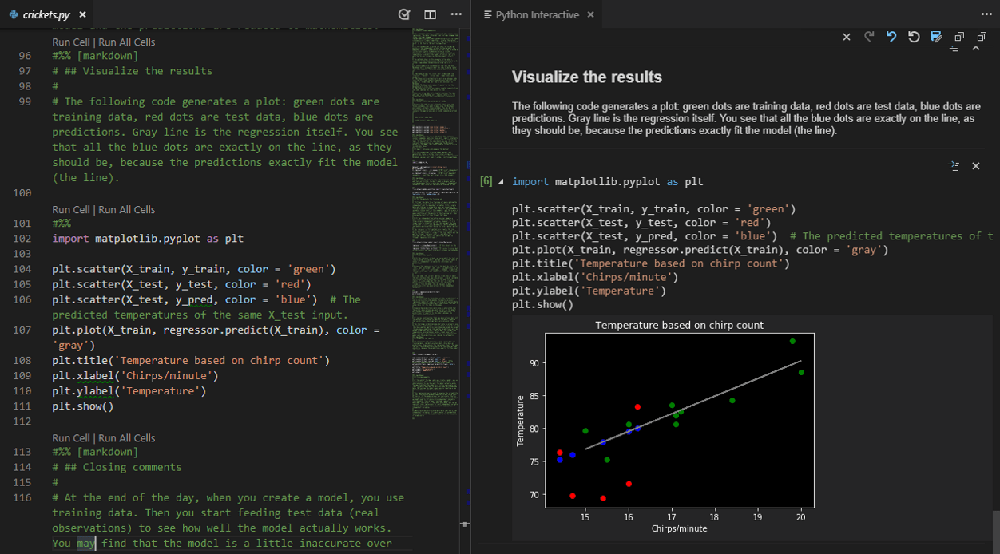
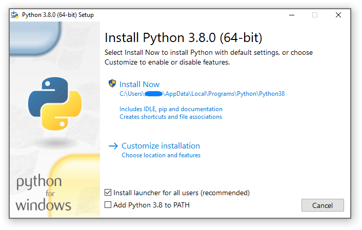
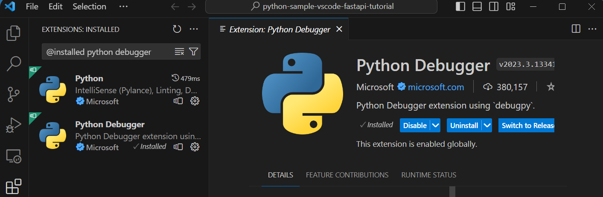
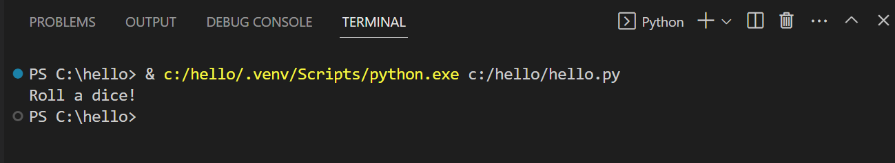
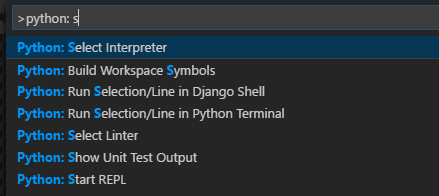
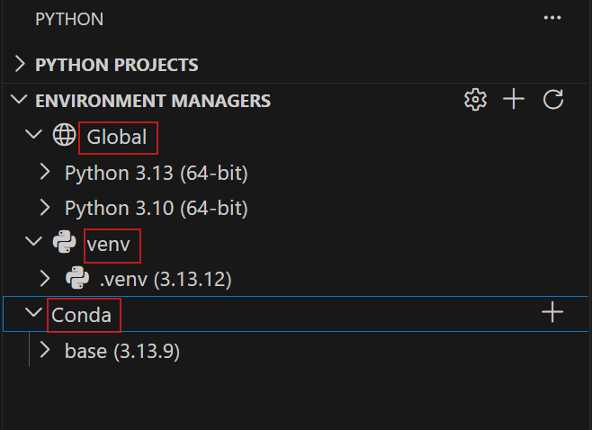

# 🐍 Python100 — Day 02

## Installing Python & VS Code: Building a Professional Development Environment

> **Goal:** Set up an enterprise-grade, clean, reproducible Python development workstation. Master the operating system PATH variable, official installer configuration, VS Code integration, interpreter resolution, and isolated virtual environments.

| | |
|---|---|
| 📚 **Series** | Mission Python 100 |
| 🗓️ **Day** | 02 |
| 🎯 **Goal** | Build an enterprise-grade, reproducible Python development environment |
| 🧰 **You will build** | `.venv`, `.vscode/settings.json`, `day02_env_check.py`, `requirements.txt` |
| ✅ **Prerequisites** | Day 01: Python, Programming & the Developer Mindset |

---

## 📑 Contents

1. [Welcome to Day 02: Why Environment Architecture Matters](#1-welcome-to-day-02-why-environment-architecture-matters)
2. [Visual Overview: The Modern VS Code Python Experience](#2-visual-overview-the-modern-vs-code-python-experience)
3. [Installing Python: Platform by Platform](#3-installing-python-platform-by-platform)
4. [The Critical Checkbox: "Add python.exe to PATH"](#4-the-critical-checkbox-add-pythonexe-to-path)
5. [Deep Dive: How the Operating System PATH Variable Works](#5-deep-dive-how-the-operating-system-path-variable-works)
6. [The Python Launcher for Windows (`py.exe`)](#6-the-python-launcher-for-windows-pyexe)
7. [Installing Visual Studio Code (VS Code)](#7-installing-visual-studio-code-vs-code)
8. [The Essential VS Code Extension Ecosystem](#8-the-essential-vs-code-extension-ecosystem)
9. [Configuring VS Code Workspace Settings (`.vscode/settings.json`)](#9-configuring-vs-code-workspace-settings-vscodesettingsjson)
10. [The Integrated Terminal & Shell Awareness](#10-the-integrated-terminal--shell-awareness)
11. [Selecting the Active Python Interpreter in VS Code](#11-selecting-the-active-python-interpreter-in-vs-code)
12. [Virtual Environments (`venv`): First Principles & Why They Exist](#12-virtual-environments-venv-first-principles--why-they-exist)
13. [Managing Environments in VS Code](#13-managing-environments-in-vs-code)
14. [Anatomy of a Virtual Environment Directory](#14-anatomy-of-a-virtual-environment-directory)
15. [Step-by-Step: Creating, Activating & Managing a `.venv`](#15-step-by-step-creating-activating--managing-a-venv)
16. [Package Management with `pip` and PyPI](#16-package-management-with-pip-and-pypi)
17. [Freezing and Reproducing Dependencies (`requirements.txt`)](#17-freezing-and-reproducing-dependencies-requirementstxt)
18. [Professional Project Directory Layout](#18-professional-project-directory-layout)
19. [First Interactive Debugging Session with Breakpoints](#19-first-interactive-debugging-session-with-breakpoints)
20. [Real-World Engineering Connection](#20-real-world-engineering-connection)
21. [Troubleshooting: The 8 Most Common Setup Bugs & Fixes](#21-troubleshooting-the-8-most-common-setup-bugs--fixes)
22. [Hands-On Practical Labs](#22-hands-on-practical-labs)
23. [Interview & Senior-Level Questions](#23-interview--senior-level-questions)
24. [Day 02 Golden Rules & Summary](#24-day-02-golden-rules--summary)

---

## 1. Welcome to Day 02: Why Environment Architecture Matters

Welcome to Day 02 of **Mission Python 100**!

Many beginner tutorials skip over workstation architecture:
> *"Just download Python, click Next, install VS Code, and start typing code."*

In software engineering, this careless approach leads to major roadblocks within days:
* Package version collisions between projects (**Dependency Hell**).
* Code running on an unexpected Python version.
* Programs working in the editor but crashing in the terminal with `ModuleNotFoundError`.
* The infamous operating system error: `'python' is not recognized as an internal or external command`.

```text
The Amateur Approach:
Global System Python ──> Install Package A (v1.0) ──> Install Package B (v2.0) ──> EVERYTHING CRASHES 💥

The Professional Engineer Approach:
Operating System
     │
     ├── Project A Sandbox (.venv_a) ──> FastAPI 0.95 + Pydantic 1.10 (Isolated ✅)
     │
     └── Project B Sandbox (.venv_b) ──> FastAPI 1.0.0 + Pydantic 2.6.0 (Isolated ✅)
```

Today, we build a **reproducible, professional development workstation** with complete clarity.

---

## 2. Visual Overview: The Modern VS Code Python Experience

Welcome to your modern Python workstation. Visual Studio Code paired with the official Python extension provides an integrated environment combining source code editing, real-time type checking, integrated terminal execution, and interactive scientific data exploration:



*Figure 2.1: The complete VS Code Python workstation displaying source editing, interactive execution pane, and live plot rendering.*

### The Three Layers of a Professional Workstation:
1. **Developer Experience Layer (VS Code & Pylance):** Code authoring, syntax highlighting, type inference, auto-formatting, and interactive debugging.
2. **Command Resolution Layer (OS Shell & PATH):** How your operating system terminal identifies and executes `python.exe` and `pip.exe`.
3. **Runtime & Package Isolation Layer (`.venv`):** An isolated sandbox containing only the specific third-party libraries needed by your active project.

---

## 3. Installing Python: Platform by Platform

Always install modern **Python 3.12+** (64-bit).

### Windows Installation:
1. Download the official 64-bit installer from [python.org/downloads](https://www.python.org/downloads/).
2. Right-click the downloaded `.exe` and select **Run as Administrator**.
3. ⚠️ **MANDATORY:** Check the box at the bottom: **"Add python.exe to PATH"**.
4. Click **Customize installation**:
   * Ensure `pip`, `tcl/tk and IDLE`, and `Python test suite` are checked.
   * Check **"Install py launcher for all users"**.
5. Advanced Options:
   * Check **"Install for all users"** (installs to `C:\Program Files\Python312` or local AppData).
   * Check **"Precompile standard library"** for faster startup.
6. Click **Install**.
7. When setup finishes, click **"Disable path length limit"** (removes the legacy Windows 260-character path ceiling).

### macOS Installation:
macOS includes an internal stub Python used by system utilities. Never alter system Python. Use **Homebrew**:
```bash
# Install Homebrew if needed
/bin/bash -c "$(curl -fsSL https://raw.githubusercontent.com/Homebrew/install/HEAD/install.sh)"

# Install modern Python
brew install python@3.12

# Verify
python3 --version
```

### Linux (Ubuntu / Debian):
```bash
sudo apt update
sudo apt install -y python3 python3-pip python3-venv python3-dev
python3 --version
```

---

## 4. The Critical Checkbox: "Add python.exe to PATH"

Why is this checkbox so critical?

When you run the official Windows installer from python.org, you are greeted with the setup wizard below:



*Figure 4.1: The official Python 64-bit setup wizard showing the critical "Add python.exe to PATH" checkbox at the bottom.*

Notice that by default, the installer leaves **"Add python.exe to PATH"** unchecked!

If you click "Install Now" without checking this box:
* Python will install into your hard drive, but your operating system will have no record of where it lives.
* When you open PowerShell or Command Prompt and type `python`, the system fails with:
  ```text
  'python' is not recognized as an internal or external command, operable program or batch file.
  ```

---

## 5. Deep Dive: How the Operating System PATH Variable Works

When you type a command in your terminal (such as `python` or `git`), the operating system does not perform a full-disk search. 

Instead, it consults an environment variable named **PATH** — an ordered, semicolon-separated list of directories:

```text
User executes: python app.py
       │
       ▼
1. OS checks: C:\Windows\System32 ────────────> Not found
2. OS checks: C:\Windows ─────────────────────> Not found
3. OS checks: C:\Users\Admin\AppData\Local\Programs\Python\Python312
       │
       └── FOUND python.exe! ──> Launches CPython runtime immediately ✅
```

### How to Inspect PATH in Your Terminal:

On Windows (PowerShell):
```powershell
# Show which python executable is chosen
where.exe python

# Print all directories in PATH
$env:PATH -split ';'
```

On Linux / macOS (Bash / Zsh):
```bash
which python3
echo $PATH | tr ':' '\n'
```

---

## 6. The Python Launcher for Windows (`py.exe`)

On Windows, the official installer places `py.exe` into `C:\Windows\py.exe` (which is always in PATH). 

`py.exe` detects all installed Python versions and routes your execution to the desired one:

```powershell
# Show all installed Python versions on your computer
py --list

# Run specifically with Python 3.11
py -3.11 main.py

# Run specifically with Python 3.12
py -3.12 main.py
```

It also respects **shebang lines** at the top of Python files:
```python
#!/usr/bin/env python3.12
print("Running on Python 3.12!")
```

---

## 7. Installing Visual Studio Code (VS Code)

**Visual Studio Code** is the industry standard for Python development:
* Lightweight, modular, and fast.
* Powered by the **Language Server Protocol (LSP)**.
* Integrated Git source control and multi-tab terminal.
* Industry-leading interactive debugger.

Download and install VS Code from [code.visualstudio.com](https://code.visualstudio.com/).
During Windows installation, check:
* ✅ **"Add 'Open with Code' action to Windows Explorer file context menu"**
* ✅ **"Add 'Open with Code' action to Windows Explorer directory context menu"**
* ✅ **"Add to PATH"**

---

## 8. The Essential VS Code Extension Ecosystem

Open VS Code, press `Ctrl + Shift + X` (or `Cmd + Shift + X` on macOS), and install the official Microsoft Python extension suite:



*Figure 8.1: Official VS Code Extension Marketplace showing the Python and Python Debugger extensions by Microsoft.*

### The Core Quartet:
1. **Python (by Microsoft):** Core support for debugging, test discovery, and interpreter selection.
2. **Pylance (by Microsoft):** High-performance language server delivering type checking, IntelliSense, auto-imports, and docstring hovers.
3. **Python Debugger (`debugpy`):** Dedicated debugger supporting breakpoints, conditional watches, and call-stack stepping.
4. **Ruff (by Astral-sh) or Black Formatter:** Lightning-fast Python linting and code formatting conforming to PEP 8 standards.

---

## 9. Configuring VS Code Workspace Settings (`.vscode/settings.json`)

To ensure consistent behavior across team members, configure project settings inside `.vscode/settings.json`:

```json
{
  "python.defaultInterpreterPath": "${workspaceFolder}/.venv/Scripts/python.exe",
  "python.terminal.activateEnvironment": true,
  "editor.formatOnSave": true,
  "editor.defaultFormatter": "charliermarsh.ruff",
  "editor.codeActionsOnSave": {
    "source.organizeImports": "explicit"
  },
  "python.analysis.typeCheckingMode": "basic",
  "python.analysis.autoImportCompletions": true,
  "files.autoSave": "onFocusChange"
}
```

> **Why this matters:** When you or a teammate clone this repository, VS Code automatically targets the project's `.venv`, formats code on save, and organizes imports according to PEP 8 standards.

---

## 10. The Integrated Terminal & Shell Awareness

VS Code features an integrated terminal (`Ctrl + ` ` ` or `` Ctrl + Shift + ` ``) that automatically connects your shell to the project environment:



*Figure 10.1: Clean terminal execution inside VS Code showing the isolated `.venv` Python binary running your script.*

Notice how VS Code executes the script by explicitly invoking the virtual environment interpreter:
```powershell
& c:/hello/.venv/Scripts/python.exe c:/hello/hello.py
```

### Execution Policy on Windows PowerShell:
If you see the error:
`File ...\Activate.ps1 cannot be loaded because running scripts is disabled on this system.`

This is a Windows default security policy preventing unapproved script execution. Fix it safely for your user account:
```powershell
Set-ExecutionPolicy -ExecutionPolicy RemoteSigned -Scope CurrentUser
```

---

## 11. Selecting the Active Python Interpreter in VS Code

VS Code allows you to point directly to any Python runtime on your machine via the Command Palette:



*Figure 11.1: Typing `Python: Select Interpreter` in the VS Code Command Palette (`Ctrl + Shift + P`).*

1. Press `Ctrl + Shift + P` (`Cmd + Shift + P` on macOS) to open the Command Palette.
2. Type: **`Python: Select Interpreter`**.
3. Select the interpreter labeled **`('..venv': venv)`**.
4. The bottom-right status bar in VS Code updates to display `3.12.x ('.venv': venv)`.

---

## 12. Virtual Environments (`venv`): First Principles & Why They Exist

### The Dependency Collision Problem:
Suppose your company runs two services:
* **Service A (Fashion Marketplace):** Built 2 years ago using `FastAPI 0.95` and `pydantic 1.10`.
* **Service B (AI Ride Dispatch):** Built today using `FastAPI 1.0` and `pydantic 2.6` (which introduces breaking API changes).

If both projects use your computer's global Python, running `pip install` on Service B will overwrite Pydantic, breaking Service A immediately.

**The Solution:** A Virtual Environment gives each project its own isolated sandbox.

---

## 13. Managing Environments in VS Code

VS Code automatically detects and categorizes all Python environments present on your machine:



*Figure 13.1: VS Code Environment Manager grouping Global runtimes, local project virtual environments (`venv`), and Conda environments.*

Notice how VS Code clearly separates:
* **Global Environments:** System-wide Python installations (e.g., Python 3.10, 3.13).
* **venv Environments:** Project-specific isolated sandboxes (`.venv`).
* **Conda Environments:** Data science environments.

---

## 14. Anatomy of a Virtual Environment Directory

A virtual environment is **not** a heavy virtual machine like VMware or Docker. It is simply a directory containing lightweight symbolic links and isolated folders:

```text
my-project/
├── .venv/
│   ├── Include/           <-- C header files for C-extensions (numpy, cryptography)
│   ├── Lib/
│   │   └── site-packages/ <-- ALL third-party pip packages live HERE (isolated!)
│   ├── Scripts/           <-- Windows binaries (python.exe, pip.exe, activate.ps1)
│   │   └── (or bin/ on macOS/Linux)
│   └── pyvenv.cfg         <-- Configuration file pointing back to base Python
├── src/
│   └── main.py
└── requirements.txt
```

### The Magic of `pyvenv.cfg`:
```ini
home = C:\Users\Admin\AppData\Local\Programs\Python\Python312
include-system-site-packages = false
version = 3.12.2
executable = C:\Users\Admin\AppData\Local\Programs\Python\Python312\python.exe
command = C:\Python312\python.exe -m venv D:\project\.venv
```
Setting `include-system-site-packages = false` ensures that global computer packages are completely ignored.

---

## 15. Step-by-Step: Creating, Activating & Managing a `.venv`

### Step 1: Open Terminal in Your Project Directory
```powershell
cd D:\Python-in-Depth
```

### Step 2: Create the Virtual Environment
```powershell
# python -m venv <directory_name>
python -m venv .venv
```

### Step 3: Activate the Environment
On Windows PowerShell:
```powershell
.\.venv\Scripts\Activate.ps1
```

On Windows CMD:
```cmd
.venv\Scripts\activate.bat
```

On macOS / Linux:
```bash
source .venv/bin/activate
```

### How You Know It Worked:
Your terminal prompt changes to show the environment prefix:
```powershell
(.venv) PS D:\Python-in-Depth>
```

### What Activation Actually Does Internally:
When you run `Activate.ps1`, it temporarily modifies your session's `$env:PATH`:
```text
Old PATH: C:\Windows\System32;C:\Python312
New PATH: D:\Python-in-Depth\.venv\Scripts;C:\Windows\System32;C:\Python312
```
Because `.venv\Scripts` is at the very front of the list, typing `python` or `pip` routes directly to the sandbox!

### Step 4: Deactivate When Done
```powershell
deactivate
```

---

## 16. Package Management with `pip` and PyPI

With your `.venv` active, install packages securely from the **Python Package Index (PyPI)**:

```powershell
# Upgrade pip inside your virtual environment
python -m pip install --upgrade pip

# Install a specific package and version
pip install requests==2.31.0

# Inspect installed packages
pip list

# Inspect detailed metadata of a package
pip show requests
```

---

## 17. Freezing and Reproducing Dependencies (`requirements.txt`)

To ensure that any team member or deployment server can recreate your exact environment:

```powershell
# 1. Export exact pinned versions to requirements.txt
pip freeze > requirements.txt

# 2. Inspect requirements.txt
cat requirements.txt
```

Example output:
```text
certifi==2024.2.2
charset-normalizer==3.3.2
idna==3.6
requests==2.31.0
urllib3==2.2.1
```

### Recreating the Environment on Another Computer:
```powershell
# On the new machine:
git clone https://github.com/your-org/project.git
cd project
python -m venv .venv
.\.venv\Scripts\Activate.ps1
pip install -r requirements.txt
```
Every dependency installs with identical versions!

---

## 18. Professional Project Directory Layout

Standard industry layout for production Python applications:

```text
fashion-service/
├── .venv/                     # Ignored by Git (Never commit this!)
├── .vscode/
│   ├── settings.json          # Workspace formatter & interpreter config
│   └── launch.json            # Debugger configurations
├── src/
│   └── fashion/
│       ├── __init__.py        # Marks directory as a Python package
│       ├── core/
│       │   ├── __init__.py
│       │   └── config.py      # Environment variables & secrets
│       ├── api/
│       │   ├── __init__.py
│       │   └── routes.py      # REST endpoints
│       └── main.py            # Application entrypoint
├── tests/
│   ├── __init__.py
│   └── test_pricing.py        # Automated pytest suite
├── .gitignore                 # Excludes .venv/, __pycache__/, .env
├── requirements.txt           # Production pinned dependencies
├── requirements-dev.txt       # Developer tooling (pytest, ruff, black)
└── README.md                  # Project setup documentation
```

### Essential `.gitignore` Rules:
```gitignore
# Byte-compiled / optimized files
__pycache__/
*.py[cod]

# Virtual environments
.venv/
env/
venv/

# Environment variables & secrets
.env
.env.local

# IDE configurations (personal)
.idea/
*.swp
```

---

## 19. First Interactive Debugging Session with Breakpoints

Create a verification script named `day02_env_check.py`:

```python
"""
Mission Python 100 — Day 02 Verification Script
Inspects active interpreter, virtual environment status, and system paths.
"""

import os
import sys


def verify_environment() -> dict:
    in_virtualenv = sys.prefix != sys.base_prefix

    return {
        "python_version": sys.version.split()[0],
        "executable_path": sys.executable,
        "is_virtual_environment": in_virtualenv,
        "base_interpreter": sys.base_prefix,
        "active_prefix": sys.prefix,
        "cwd": os.getcwd(),
    }


if __name__ == "__main__":
    report = verify_environment()
    print("=" * 65)
    print("🚀 PYTHON ENVIRONMENT DIAGNOSTIC REPORT (Day 02)")
    print("=" * 65)
    for key, val in report.items():
        print(f"  {key:<25}: {val}")
    print("=" * 65)

    if report["is_virtual_environment"]:
        print("  Status: ✅ SUCCESS — Running inside an isolated virtual environment (.venv)!")
    else:
        print("  Status: ⚠️ WARNING — Running in global system Python. Activate your .venv!")
    print("=" * 65)
```

### Step-by-Step Debugging in VS Code:
1. Open `day02_env_check.py` in VS Code.
2. Click to the left of line 11 (`in_virtualenv = sys.prefix != sys.base_prefix`) to set a **Red Breakpoint** (or press `F9`).
3. Press **`F5`** (select *Python Debugger: Python File*).
4. Execution pauses on line 11!
5. Inspect the **Run & Debug** pane on the left:
   * **Variables:** View local variables and values in real time.
   * **Watch:** Type expressions like `sys.prefix` to evaluate on the fly.
   * **Call Stack:** Inspect the current execution frame.
6. Press **`F10`** to Step Over, or **`F5`** to continue execution.

---

## 20. Real-World Engineering Connection

How does today's setup directly power the enterprise architectures introduced in Day 01?

| Architecture | Local Environment Setup Pattern |
|---|---|
| **🏢 Enterprise ERP / Payroll** | Uses locked `pip-tools` or `Poetry` inside `.venv` to enforce strict deterministic package versions for multi-developer tax calculation compliance. |
| **🛍️ Fashion Marketplace** | Multiple microservices (`catalog-service`, `order-service`) each maintain independent `.venv` directories to avoid library collisions between legacy and modern APIs. |
| **🚗 Uber-Like Platform** | Docker containers mirror local `.venv` setups using identical `requirements.txt` to eliminate differences between local laptops and AWS ECS cloud clusters. |

---

## 21. Troubleshooting: The 8 Most Common Setup Bugs & Fixes

### 1. `'python' is not recognized as an internal or external command`
* **Root Cause:** Python was installed without checking "Add python.exe to PATH".
* **Instant Fix:** Re-run the installer, choose *Modify*, and check **"Add python.exe to PATH"**. Or manually add `C:\Users\<User>\AppData\Local\Programs\Python\Python312` to your user Environment Variables.

### 2. `ExecutionPolicy Error on Windows PowerShell`
* **Root Cause:** PowerShell restricts unsigned script execution by default.
* **Instant Fix:** Run `Set-ExecutionPolicy -ExecutionPolicy RemoteSigned -Scope CurrentUser` in PowerShell.

### 3. VS Code uses Global Python instead of `.venv`
* **Root Cause:** Interpreter path not set in workspace settings.
* **Instant Fix:** Press `Ctrl + Shift + P` $\rightarrow$ `Python: Select Interpreter` $\rightarrow$ select `('..venv': venv)`.

### 4. `ModuleNotFoundError: No module named 'requests'`
* **Root Cause:** Package was installed in one environment, but the script is running in another.
* **Instant Fix:** Check `sys.executable` to verify the active interpreter, ensure `(.venv)` is active, and run `pip install requests` inside that environment.

### 5. `pip install` throws Access Denied / Permission Error
* **Root Cause:** Trying to install into global `C:\Program Files` without Admin rights.
* **Instant Fix:** Always use a virtual environment (`.venv`), where packages are installed into your user project directory with zero administrator restrictions.

### 6. Terminal prompt does not display `(.venv)`
* **Root Cause:** Script activation was bypassed.
* **Instant Fix:** Run `.\.venv\Scripts\Activate.ps1` explicitly.

### 7. Virtual environment broken after moving project folder
* **Root Cause:** `pyvenv.cfg` and scripts store absolute filesystem paths.
* **Instant Fix:** Delete the `.venv` folder (`rm -r .venv`) and re-create it in 10 seconds: `python -m venv .venv && .\.venv\Scripts\activate && pip install -r requirements.txt`.

### 8. Python opens the Windows Store instead of running
* **Root Cause:** Windows 10/11 "App Execution Aliases" intercepting `python.exe`.
* **Instant Fix:** Windows Settings $\rightarrow$ Search *Manage app execution aliases* $\rightarrow$ Turn OFF `App Installer (python.exe)` and `App Installer (python3.exe)`.

---

## 22. Hands-On Practical Labs

### Lab A — Verification:
Run `day02_env_check.py` and confirm that `is_virtual_environment` returns `True`.

### Lab B — Dependency Management:
1. Activate your `.venv`.
2. Install `requests` and `rich`:
   ```powershell
   pip install requests rich
   ```
3. Generate `requirements.txt`:
   ```powershell
   pip freeze > requirements.txt
   ```
4. Confirm that both libraries and their sub-dependencies appear in `requirements.txt`.

### Lab C — Deliberate Error Injection:
1. Open PowerShell **without activating `.venv`**.
2. Try importing `requests` using `python -c "import requests"`.
3. Observe the `ModuleNotFoundError`.
4. Now activate `.venv` and re-run. Observe how the error vanishes.

---

## 23. Interview & Senior-Level Questions

### 1. Junior Level: What does the PATH environment variable do, and what happens when it is misconfigured?
> **Answer:** PATH is an operating system environment variable containing an ordered list of directory paths. When an executable name is invoked in a shell without an absolute path, the OS traverses these directories from left to right until it finds a matching binary. If it reaches the end of the list without a match, it raises a command-not-found error.

### 2. Intermediate Level: How does Python determine whether it is running inside a virtual environment?
> **Answer:** Python compares `sys.prefix` (the current active execution prefix) with `sys.base_prefix` (the base interpreter path). When running in global Python, `sys.prefix == sys.base_prefix`. Inside a virtual environment, `sys.prefix` points to the `.venv` directory, while `sys.base_prefix` points to the root Python installation.

### 3. Senior Level: Why should `.venv` directories never be committed to Git or copied between different host operating systems?
> **Answer:** 
> 1. Virtual environments contain compiled platform-specific machine code binaries (e.g. `.exe` on Windows vs ELF binaries on Linux) in their `Scripts/` or `bin/` folders, which cannot run across different OS kernels.
> 2. `pyvenv.cfg` records hardcoded absolute filesystem paths specific to the developer's local machine.
> 3. C-extensions compiled for one architecture (e.g. x86_64 vs ARM64) will fail on another. Instead, commit only `requirements.txt` or `pyproject.toml` and rebuild the `.venv` natively on the host or inside a Docker container.

---

## 24. Day 02 Golden Rules & Summary

```text
╔══════════════════════════════════════════════════════════════════════════╗
║                    DAY 02 GOLDEN RULES TO LIVE BY                        ║
╠══════════════════════════════════════════════════════════════════════════╣
║ 1. One project, one virtual environment (.venv). Never install globally. ║
║ 2. Always verify your interpreter with sys.executable before debugging.  ║
║ 3. Never commit .venv/ or credentials to Git. Put them in .gitignore.    ║
║ 4. Always pin production dependencies using requirements.txt.            ║
║ 5. Treat environment setup as software architecture, not an afterthought.║
╚══════════════════════════════════════════════════════════════════════════╝
```

---

| ⬅️ Previous | ➡️ Next |
|---|---|
| [Day 01: Python, Programming & Developer Mindset](Day01-Python,%20Programming%20&%20the%20Developer%20Mindset.md) | [Day 03: Python REPL and First Programs](Day03-Python%20REPL%20and%20first%20programs.md) |
| 🏁 **Day 02 complete** | **Return to [README](README.md)** |
