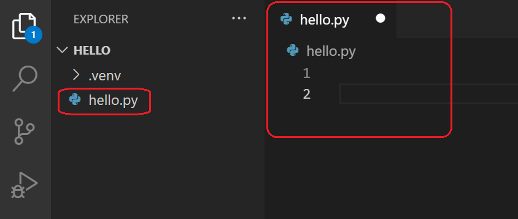
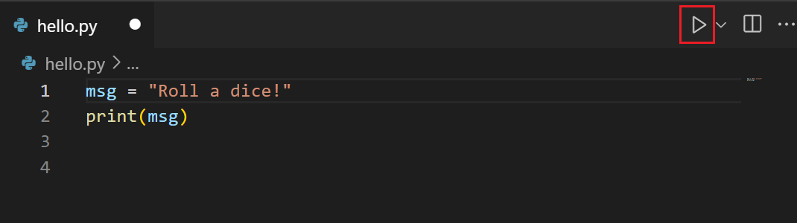
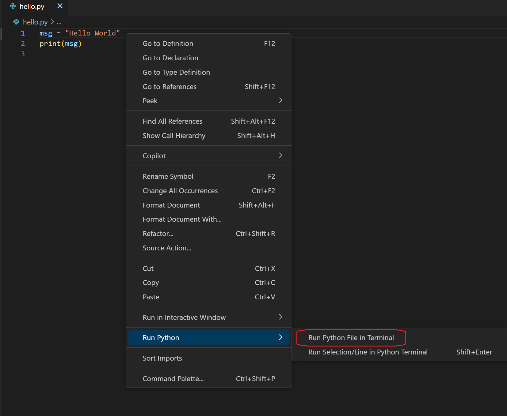
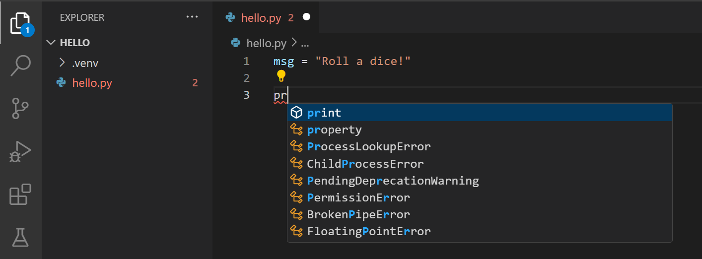
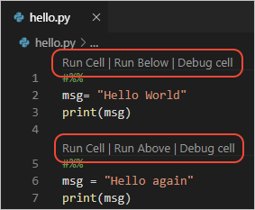
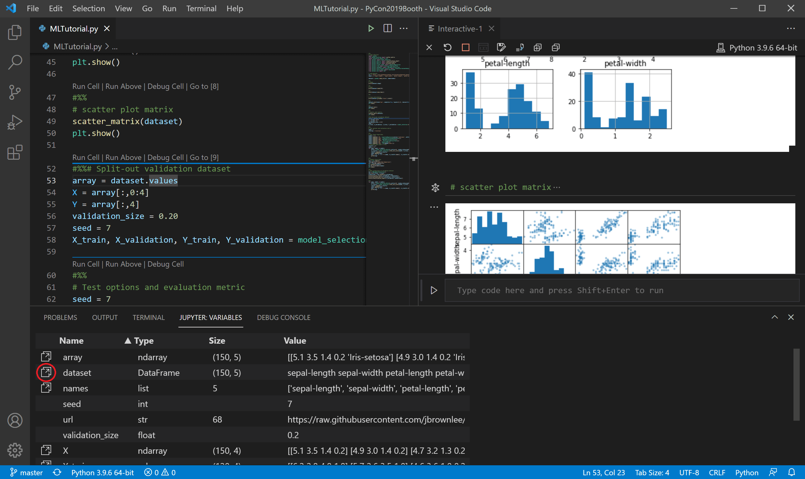

# 🐍 Day 03: Python REPL and First Programs

> **Masterclass Series:** Python in Depth — 100-Day Engineering Curriculum  
> **Topic:** The Read-Eval-Print Loop (REPL), CPython Interactive Architecture, Command-Line Flags, Script Execution, and First Programs  
> **Prerequisites:** [Day 01: Python, Programming & the Developer Mindset](<Day01-Python, Programming & the Developer Mindset.md>), [Day 02: Installing Python and VS Code](<Day02-Installing Python and VS Code.md>)  
> **Companion Script:** [`day03_repl_mastery.py`](day03_repl_mastery.py)

---

## 📑 Comprehensive Chapter Index

1. [Why the Python REPL & Script Execution Matter](#1-why-the-python-repl--script-execution-matter)
2. [Visual Architecture: The Interactive Workspace & Terminal](#2-visual-architecture-the-interactive-workspace--terminal)
3. [The CPython REPL Under the Hood: Read-Eval-Print Architecture](#3-the-cpython-repl-under-the-hood-read-eval-print-architecture)
4. [Expressions vs. Statements: Why REPL Prints Without `print()`](#4-expressions-vs-statements-why-repl-prints-without-print)
5. [The Secret Interactive Variable: `_` (Underscore)](#5-the-secret-interactive-variable-_-underscore)
6. [The Modern Python REPL: Python 3.13+ PyREPL Architecture](#6-the-modern-python-repl-python-313-pyrepl-architecture)
7. [Customizing Prompts: `sys.ps1`, `sys.ps2`, and Terminal Colors](#7-customizing-prompts-sysps1-sysps2-and-terminal-colors)
8. [Interactive Introspection: `dir()`, `type()`, `id()`, and `help()`](#8-interactive-introspection-dir-type-id-and-help)
9. [Command-Line Execution Modes: `python`, `-c`, `-m`, and `-i`](#9-command-line-execution-modes-python--c--m-and--i)
10. [The Power of `python -i`: Post-Mortem Interactive Debugging](#10-the-power-of-python--i-post-mortem-interactive-debugging)
11. [Creating Your First Python Script (`hello.py`)](#11-creating-your-first-python-script-hellopy)
12. [Running Scripts: Integrated Terminal vs Editor Play Button](#12-running-scripts-integrated-terminal-vs-editor-play-button)
13. [IntelliSense & Language Server Protocol (LSP) in First Programs](#13-intellisense--language-server-protocol-lsp-in-first-programs)
14. [Standard Streams & Operating System Exit Codes (`sys.exit`)](#14-standard-streams--operating-system-exit-codes-sysexit)
15. [Interactive Code Cells & VS Code Python Interactive Window](#15-interactive-code-cells--vs-code-python-interactive-window)
16. [Live State & Variable Explorer in Interactive Workflows](#16-live-state--variable-explorer-in-interactive-workflows)
17. [Bytecode Caching Demystified: Why REPL Skips `.pyc` Files](#17-bytecode-caching-demystified-why-repl-skips-pyc-files)
18. [Building Your Own REPL in Python: The `code` Module](#18-building-your-own-repl-in-python-the-code-module)
19. [Hands-On Lab: Predictive Evaluation & Tracebacks](#19-hands-on-lab-predictive-evaluation--tracebacks)
20. [Deliberate Failure Lab: SyntaxError vs NameError vs TypeError](#20-deliberate-failure-lab-syntaxerror-vs-nameerror-vs-typeerror)
21. [Real-World Engineering Scenarios: Production Debugging Consoles](#21-real-world-engineering-scenarios-production-debugging-consoles)
22. [Pythonic First Program Conventions & Clean Code Habits](#22-pythonic-first-program-conventions--clean-code-habits)
23. [Senior Technical Interview & Architectural Q&A](#23-senior-technical-interview--architectural-qa)
24. [Day 03 Mastery Checklist & Next Steps](#24-day-03-masterly-checklist--next-steps)

---

## 1. Why the Python REPL & Script Execution Matter

Every developer begins their journey by typing code and watching a computer respond. In most compiled languages (like C, C++, Rust, or Go), this requires an edit-compile-link-execute sequence that creates high latency between forming a hypothesis and testing it.

Python provides two complementary paradigms:
1. **The Interactive REPL (Read-Eval-Print Loop):** An exploratory laboratory where you can interact directly with the running CPython virtual machine. You can create objects, inspect live memory pointers, invoke experimental functions, and query documentation without writing files or restarting programs.
2. **Persistent Script Files (`.py`):** Deterministic, reproducible, source-controlled artifacts designed for automated testing, build pipelines, microservices, and serverless executions.

Mastering both allows senior engineers to prototype algorithms and query production datasets in real-time while shipping clean, immutable codebases.

---

## 2. Visual Architecture: The Interactive Workspace & Terminal

In modern software development, our workstation bridges text editing with interactive execution. Visual Studio Code integrates an editor pane with an active Python runtime terminal.



When working with Python files:
- The editor tab displays persistent source code (`hello.py`).
- The bottom panel provides an active terminal session tied to your selected Python virtual environment (`.venv`).
- Changes made in the editor can be dispatched directly into the terminal or executed as an isolated process.

---

## 3. The CPython REPL Under the Hood: Read-Eval-Print Architecture

When you type `python` (or `python3`) into your shell without passing a file path, CPython initiates its interactive loop. The term **REPL** stands for four distinct phases:

```
[ User Input (stdin) ]
        │
        ▼
   1. READ   ──────► Lexical Scanner & Parser tokenizes string into AST
        │            (Buffers multiline blocks until blank line or closing token)
        ▼
   2. EVAL   ──────► Compiler transforms AST into transient Code Object
        │            CPython CEval VM executes bytecode on the evaluation stack
        ▼
   3. PRINT  ──────► sys.displayhook renders repr(result) if result is not None
        │            Assigns returned object to builtins._
        ▼
   4. LOOP   ──────► Re-renders prompt (sys.ps1 = ">>> ") and awaits next input
```

### The Four Phases in CPython:

1. **READ (`PyTokenizer` & Parser):** Reads bytes from standard input (`stdin`). If an incomplete compound statement is entered (e.g., `def calculate():`), CPython changes the prompt from primary `sys.ps1` (`>>> `) to secondary `sys.ps2` (`... `), collecting tokens until grammar rules are satisfied.
2. **EVAL (`PyAST_FromNode` & `PyEval_EvalCode`):** Compiles the AST into an in-memory `code` object. Crucially, interactive compilation mode uses the compilation flag `single`, which treats top-level expressions specially compared to module-level script mode.
3. **PRINT (`sys.displayhook`):** If the evaluated expression produces any Python object other than `None`, CPython calls `sys.displayhook(obj)`, which writes the string output of `repr(obj)` to `sys.stdout`.
4. **LOOP:** The execution environment preserves all global namespace symbols (`globals()`), retains open file handles and network sockets, updates the interactive history file, and yields control back to the terminal.

---

## 4. Expressions vs. Statements: Why REPL Prints Without `print()`

A common question beginners ask is: *Why does typing `2 + 3` in the REPL print `5`, but writing `2 + 3` inside a `.py` file prints nothing?*

The difference lies between **Expressions** and **Statements**, and how the CPython compilation mode handles them:

| Concept | Definition | Example | REPL Behavior | Script (`.py`) Behavior |
|---|---|---|---|---|
| **Expression** | Code that evaluates to a value | `2 + 3`, `"data".upper()`, `len([1,2])` | Evaluated, passed to `sys.displayhook`, printed | Evaluated on stack and immediately discarded (unless assigned or passed to a function) |
| **Statement** | An action or instruction that performs work | `x = 10`, `import math`, `def fn(): pass` | Executes action, returns `None`; prints nothing | Executes action, returns `None`; prints nothing |
| **Function Call** | Evaluates a callable | `print("hello")` | Prints `"hello"` via `sys.stdout`; returns `None` (no extra output) | Prints `"hello"` via `sys.stdout`; returns `None` |

### Demonstrating `sys.displayhook`

In the REPL, whenever an expression is evaluated, CPython invokes `sys.displayhook`:

```python
>>> import sys
>>> def custom_displayhook(value):
...     if value is not None:
...         sys.stdout.write(f"Result Object: {type(value).__name__} => {value!r}\n")
...
>>> sys.displayhook = custom_displayhook
>>> 42 * 10
Result Object: int => 420
>>> "production"
Result Object: str => 'production'
```

Inside a `.py` script, Python uses `exec` mode rather than `single` mode; expressions that are not assigned or printed generate a bytecode instruction called `POP_TOP`, which silently removes the result from the stack.

---

## 5. The Secret Interactive Variable: `_` (Underscore)

CPython reserves the single underscore identifier `_` in the interactive shell to store the **result of the last unassigned evaluated expression**.

```python
>>> 1500 * 1.18          # Price with 18% VAT
1770.0
>>> _                    # The underscore holds 1770.0
1770.0
>>> _ * 0.90             # Apply a 10% loyalty discount to the previous result
1593.0
>>> _ / 3                # Split the discounted total among 3 participants
531.0
```

> [!WARNING]
> If you manually assign a value to `_` (e.g., `_ = 100` or `for _ in range(5):`), you overwrite the built-in dynamic link with a local variable name. To restore dynamic evaluation behavior in that session, execute `del _`.

---

## 6. The Modern Python REPL: Python 3.13+ PyREPL Architecture

Starting in **Python 3.13**, CPython replaced the legacy GNU Readline / basic console REPL with **PyREPL** — a modern, pure-Python interactive engine originally developed in PyPy.

```
      Legacy REPL (<= 3.12)                   Modern PyREPL (3.13+)
┌─────────────────────────────────┐   ┌─────────────────────────────────────┐
│ • Single-line cursor movement   │   │ • Full multiline cursor navigation  │
│ • Monochromatic text only       │   │ • Native ANSI syntax highlighting   │
│ • Pasting multiline code broke  │   │ • Paste-mode without indentation bug│
│ • Help required opening pager   │   │ • F1 / F2 / F3 interactive help     │
│ • Platform-specific readline    │   │ • Persistent cross-session history  │
└─────────────────────────────────┘   └─────────────────────────────────────┘
```

### Key Features of Python 3.13 PyREPL:
- **Multiline Editing:** You can use the Up and Down arrow keys to edit previously typed lines in a multiline function definition before hitting Enter.
- **Colorized Tracebacks & Syntax:** Keywords, strings, numbers, and errors appear color-coded out of the box in modern terminals.
- **Interactive Commands:**
  - `F1`: Interactive help viewer.
  - `F2`: Toggle line numbers and prompt display.
  - `F3`: Enter multiline paste mode.
- **Environment Override:** You can force the legacy REPL by setting the environment variable `PYTHON_BASIC_REPL=1`.

---

## 7. Customizing Prompts: `sys.ps1`, `sys.ps2`, and Terminal Colors

The primary (`>>> `) and secondary (`... `) prompts in Python are controlled by two attributes in the `sys` module: `sys.ps1` and `sys.ps2`.

Because these are standard string attributes, you can dynamically customize them to show active timestamps, virtual environment names, or ANSI color codes:

```python
>>> import sys
>>> # Add bold cyan prompt
>>> sys.ps1 = "\033[1;36m[Python 3.13] >>> \033[0m"
[Python 3.13] >>> x = [1, 2, 3]
[Python 3.13] >>> sys.ps2 = "\033[1;33m[Continuation] ... \033[0m"
[Python 3.13] >>> for item in x:
[Continuation] ...     print(item * 2)
...
2
4
6
```

---

## 8. Interactive Introspection: `dir()`, `type()`, `id()`, and `help()`

The primary advantage of the REPL is interactive introspection — inspecting objects live in memory without recompilation:

```python
>>> import math
>>> type(math.pi)
<class 'float'>

>>> id(math.pi)             # Memory address of the float object
2138974823120

>>> dir(math)               # List all attributes and functions in math module
['__doc__', '__loader__', '__name__', '__package__', '__spec__', 'acos', 
 'asin', 'atan', 'ceil', 'cos', 'exp', 'floor', 'isqrt', 'pi', 'sin', 'sqrt', ...]

>>> help(math.isqrt)        # Read docstring directly from CPython binary
Help on built-in function isqrt in module math:

isqrt(n, /)
    Return the integer part of the nonnegative square root of n.
```

---

## 9. Command-Line Execution Modes: `python`, `-c`, `-m`, and `-i`

The Python CLI offers distinct execution flags that determine how the interpreter processes your input:

```
                  ┌───────────────────────┐
                  │ python [flags] [args] │
                  └───────────┬───────────┘
                              │
         ┌────────────────────┼───────────────────┬───────────────────┐
         ▼                    ▼                   ▼                   ▼
    Interactive           Run Script          Run Module         One-Liner
     `python`          `python app.py`       `python -m venv`   `python -c "..."`
  Interactive REPL       Compiles AST         Locates module     Compiles single
  Awaits stdin lines    Runs in __main__      in sys.path        string expression
```

### The 5 Standard Execution Modes:

1. **Interactive REPL (`python`):** No arguments. Opens interactive prompt session.
2. **Script Mode (`python app.py`):** Reads `app.py`, sets `__name__ = '__main__'`, executes all top-level statements, and exits upon completion.
3. **Command String (`python -c "<code>"`):** Evaluates a Python code string directly from the terminal without saving to disk:
   ```bash
   python -c "import sys; print(sys.version.split()[0])"
   ```
4. **Module Runner (`python -m <module>`):** Searches `sys.path` for the module, runs it as `__main__`. Recommended for tools:
   ```bash
   python -m venv .venv
   python -m http.server 8000
   python -m timeit "[x**2 for x in range(1000)]"
   ```
5. **Interactive Inspection Mode (`python -i <file>`):** Executes the file, but **does not exit**. Drops immediately into the REPL with all variables in memory.

---

## 10. The Power of `python -i`: Post-Mortem Interactive Debugging

`python -i` is one of the most effective debugging tools in the Python developer workflow.

Imagine you have a file named `process_order.py`:

```python
# process_order.py
catalog = {"sku_101": 29.99, "sku_102": 49.50, "sku_103": 89.00}
cart = ["sku_101", "sku_103", "sku_101"]

subtotal = sum(catalog[item] for item in cart)
discount = 0.15 if subtotal > 100 else 0.0
final_total = round(subtotal * (1 - discount), 2)
```

Run it with the `-i` flag:

```bash
python -i process_order.py
```

```python
>>> # The script executed and finished, but Python kept the process alive!
>>> subtotal
148.98
>>> discount
0.15
>>> final_total
126.63
>>> # Now you can test changes live:
>>> cart.append("sku_102")
>>> sum(catalog[item] for item in cart)
198.48
```

You can inspect failed state, test alternative calculations, and diagnose errors without inserting print statements and re-running.

---

## 11. Creating Your First Python Script (`hello.py`)

A script file preserves code permanently on disk. Create a workspace folder and generate `hello.py`:

```python
"""
Module: hello.py
Description: Modern, production-grade first Python script.
"""

import sys
import platform

def generate_greeting(target: str) -> str:
    """Format an enterprise greeting with localized platform context."""
    cleaned_target = target.strip().title()
    return f"Hello, {cleaned_target}! Welcome to Python {platform.python_version()} on {platform.system()}."

def main() -> None:
    """Main program entry point."""
    user = "Software Engineer"
    message = generate_greeting(user)
    print(message)
    print(f"Runtime Executable: {sys.executable}")

if __name__ == "__main__":
    main()
```

### Why Use `if __name__ == "__main__":`?
When Python executes a file directly, it sets the hidden global variable `__name__` to `"__main__"`. If the file is imported by another script (e.g., `import hello`), `__name__` is set to `"hello"`. This construct allows a file to be both **executable as a standalone tool** and **importable as a clean library** without side-effects.

---

## 12. Running Scripts: Integrated Terminal vs Editor Play Button

VS Code provides dedicated controls to run Python files directly from the UI:



### The Execution Workflow:



1. **Clicking the Play Button:** VS Code opens the integrated terminal, activates your project's `.venv`, and sends the execution command:
   ```bash
   & d:/Python-in-Depth/.venv/Scripts/python.exe d:/Python-in-Depth/hello.py
   ```
2. **Running via Direct CLI Command:** Open the terminal (`Ctrl + ~`) and execute:
   ```bash
   python hello.py
   ```

Both methods run through the CPython interpreter and stream output to standard output (`stdout`).

---

## 13. IntelliSense & Language Server Protocol (LSP) in First Programs

When typing Python code in VS Code, the **Pylance** language server constantly parses your code in the background using the Language Server Protocol (LSP).



- **Parameter Info:** Hovering over `print()` or custom functions displays argument definitions, defaults, and docstrings.
- **Type Checking:** Pylance highlights invalid argument types before you execute the program.
- **Auto-Imports:** Typing standard library functions offers auto-import suggestions.

---

## 14. Standard Streams & Operating System Exit Codes (`sys.exit`)

Every process executed by an operating system communicates through three standard I/O streams and an integer return code:

```
                     ┌───────────────────────────┐
                     │     Python Process        │
                     │                           │
  sys.stdin   ──────►│  Read input from console  │
                     │                           │
                     │  Write normal messages   ├──────► sys.stdout (Stream 1)
                     │                           │
                     │  Write error diagnostics  ├──────► sys.stderr (Stream 2)
                     └─────────────┬─────────────┘
                                   │
                                   ▼
                    Exit Status Code (0 to 255)
                    0 = SUCCESS, 1-255 = FAILURE
```

```python
import sys

def check_disk_space(required_gb: int) -> None:
    available_gb = 5
    if available_gb < required_gb:
        # Write error specifically to stderr, not stdout
        sys.stderr.write(f"FATAL: Insufficient disk space ({available_gb}GB < {required_gb}GB)\n")
        sys.exit(1)  # Non-zero exit code signals failure to CI/CD pipelines
    
    print("Disk check passed.")
    sys.exit(0)      # 0 signals successful completion
```

In PowerShell or Bash, check the exit code immediately after execution:
```powershell
python -c "import sys; sys.exit(0)"
$LASTEXITCODE
# Output: 0

python -c "import sys; sys.exit(42)"
$LASTEXITCODE
# Output: 42
```

---

## 15. Interactive Code Cells & VS Code Python Interactive Window

You do not need Jupyter Notebooks (`.ipynb`) to enjoy cell-by-cell interactive execution. In standard `.py` files, VS Code supports **Interactive Code Cells** using the comment marker `#%%`.



```python
#%% Cell 1: Ingest Data
data = [10, 20, 30, 40, 50]
print(f"Loaded {len(data)} items")

#%% Cell 2: Transform Data
normalized = [x / sum(data) for x in data]
print(f"Normalized probabilities: {normalized}")

#%% Cell 3: Verify Invariant
assert round(sum(normalized), 5) == 1.00000
print("Invariant holds: sum equals 1.0")
```

Pressing `Shift + Enter` on any cell sends that block directly to the **Interactive Window**, keeping variables in memory between runs.

---

## 16. Live State & Variable Explorer in Interactive Workflows

When working interactively, keeping track of in-memory state is critical. The VS Code Interactive Window includes a built-in **Variable Explorer**:



The Variable Explorer allows you to:
- Inspect variable names, data types, sizes, and active values.
- View multi-dimensional collections and data structures in a tabular grid without cluttering your terminal with `print()` calls.
- Track state changes across iterations in real-time.

---

## 17. Bytecode Caching Demystified: Why REPL Skips `.pyc` Files

When you execute a Python file (`python main.py`), CPython compiles your human-readable source into bytecode and saves it in a directory named `__pycache__` as a compiled `.pyc` file (e.g., `main.cpython-313.pyc`).

However, **the interactive REPL never writes `.pyc` files to disk**.

### Why?
1. **Transience:** In the REPL, commands are typed interactively and discarded when the session ends. There is no timestamped source file on disk to compare against for cache invalidation.
2. **Compilation Flag:** The REPL compiles each line using the `single` compilation symbol directly into transient RAM memory, bypassing disk I/O for instantaneous feedback.

---

## 18. Building Your Own REPL in Python: The `code` Module

CPython provides standard library modules (`code` and `codeop`) that allow you to embed an interactive REPL inside your own applications:

```python
import code

def start_diagnostic_console(user_id: int, permissions: list[str]) -> None:
    banner = "=== PRODUCTION DIAGNOSTIC REPL ===\nType exit() to terminate."
    # Expose only specific variables to the interactive session
    context = {
        "user_id": user_id,
        "permissions": permissions,
        "grant_admin": lambda: permissions.append("admin"),
    }
    code.interact(banner=banner, local=context)

if __name__ == "__main__":
    start_diagnostic_console(1048, ["read", "write"])
```

When this script runs, it suspends execution and gives the user an interactive `>>> ` prompt with the `user_id` and `permissions` objects preloaded!

---

## 19. Hands-On Lab: Predictive Evaluation & Tracebacks

Execute the companion script to observe runtime diagnostics:

```bash
python day03_repl_mastery.py
```

### Lab Exercise: Predict Before Running

Predict the output of the following REPL sequence before typing it into your terminal:

```python
>>> a = [1, 2, 3]
>>> b = a
>>> b.append(4)
>>> a
???
>>> 10 / 2
???
>>> _ * 3
???
```

**Verification:**
1. `a` evaluates to `[1, 2, 3, 4]` because `b` and `a` share a reference to the exact same mutable list object on the heap.
2. `10 / 2` evaluates to float `5.0`.
3. `_ * 3` evaluates to `15.0` because `_` held the float result `5.0`.

---

## 20. Deliberate Failure Lab: SyntaxError vs NameError vs TypeError

Understanding how the REPL reports errors builds fast diagnostic reflexes. Deliberately trigger and observe these three fundamental errors:

```python
# 1. SyntaxError: Detected by the Parser in the READ phase before execution starts
>>> for x in range(3)
  File "<stdin>", line 1
    for x in range(3)
                    ^
SyntaxError: expected ':'

# 2. NameError: Detected during the EVAL phase when a variable name is not in globals() or builtins
>>> print(undefined_variable)
Traceback (most recent call last):
  File "<stdin>", line 1, in <module>
NameError: name 'undefined_variable' is not defined

# 3. TypeError: Detected during the EVAL phase when an operation is invalid for the object types
>>> "Total: " + 100
Traceback (most recent call last):
  File "<stdin>", line 1, in <module>
TypeError: can only concatenate str (not "int") to str
```

---

## 21. Real-World Engineering Scenarios: Production Debugging Consoles

In production engineering, the REPL is used far beyond basic math:

1. **Django & Flask Interactive Shells:**
   ```bash
   python manage.py shell
   ```
   Loads database connections, ORM models, and settings into an interactive REPL to query production databases without writing ad-hoc scripts.
2. **Kubernetes Pod Debugging:**
   ```bash
   kubectl exec -it python-backend-pod -- python -i
   ```
   Attaches an interactive Python session to a live container to check environment variables, test network connectivity to databases, and inspect runtime caches.
3. **Data Science Exploration:**
   Data engineers use IPython / REPL sessions to load multi-gigabyte Parquet datasets into memory once, and then rapidly test dozens of aggregations without reloading the dataset.

---

## 22. Pythonic First Program Conventions & Clean Code Habits

When writing `.py` script files, follow these production standards:

```python
# ❌ ANTI-PATTERN: Loose, untyped global code with side effects on import
import os, sys
x = 10
y = 20
print("Calculating...")
print(x + y)

# ✅ PYTHONIC MASTERCLASS: Modular, typed, encapsulated, and safe to import
from typing import Final

DEFAULT_FACTOR: Final[float] = 1.08

def calculate_invoice_total(subtotal: float, tax_rate: float = DEFAULT_FACTOR) -> float:
    """Calculate and round final invoice amount."""
    if subtotal < 0:
        raise ValueError(f"Subtotal cannot be negative: {subtotal}")
    return round(subtotal * tax_rate, 2)

def main() -> None:
    sample_subtotal = 250.00
    total = calculate_invoice_total(sample_subtotal)
    print(f"Invoice Total: ${total:.2f}")

if __name__ == "__main__":
    main()
```

---

## 23. Senior Technical Interview & Architectural Q&A

### Q1: What is the architectural difference between `sys.displayhook` and `print()`?
**Answer:** `print()` is a built-in function that takes objects, converts them to strings using `str()`, writes them to `sys.stdout`, and returns `None`. `sys.displayhook` is an interactive loop system hook invoked only when an expression statement evaluates to a non-`None` value in the REPL. `sys.displayhook` uses `repr()` rather than `str()` to provide an unambiguous programmer's representation, formats the output, and assigns the object to `builtins._`.

### Q2: Why is `python -m pip install` preferred over invoking `pip install` directly?
**Answer:** `python -m pip` guarantees that the `pip` module belonging to the *exact Python interpreter currently executing* is used. If multiple Python versions or virtual environments exist on a machine, running `pip` directly might invoke a different global binary found earlier in the system `PATH`, installing libraries into the wrong environment.

### Q3: What happens when you run `python -O script.py`?
**Answer:** The `-O` (optimize) flag causes CPython to compile bytecode that removes all `assert` statements and sets `__debug__ = False`. Using `-OO` additionally strips out all docstrings (`__doc__`), reducing memory overhead.

---

## 24. Day 03 Mastery Checklist & Next Steps

Before moving to **Day 04**, verify your mastery of the following skills:

- [x] Launched the CPython interactive REPL from terminal using `python`.
- [x] Evaluated expressions and utilized `_` to chain calculations.
- [x] Inspected functions and modules using `dir()`, `type()`, and `help()`.
- [x] Executed a script using `python script.py` and examined exit codes using `$LASTEXITCODE` or `echo $?`.
- [x] Tested post-mortem inspection using `python -i day03_repl_mastery.py`.
- [x] Used the VS Code Python Play button and verified execution in the integrated terminal.
- [x] Tested interactive code cells with `#%%` and inspected variables in the Variable Explorer.
- [x] Embedded a custom REPL using `code.interact()`.

```bash
# Save and commit your Day 03 progress
git add "Day03-Python REPL and first programs.md" day03_repl_mastery.py
git commit -m "feat(day03): complete Python REPL and first programs masterclass"
```

**Next Chapter:** [Day 04: Pythonic Style and PEP 8](<Day04-Pythonic style and PEP 8.md>) — Deep dive into clean code conventions, flake8, black, ruff, naming paradigms, and the Zen of Python.
