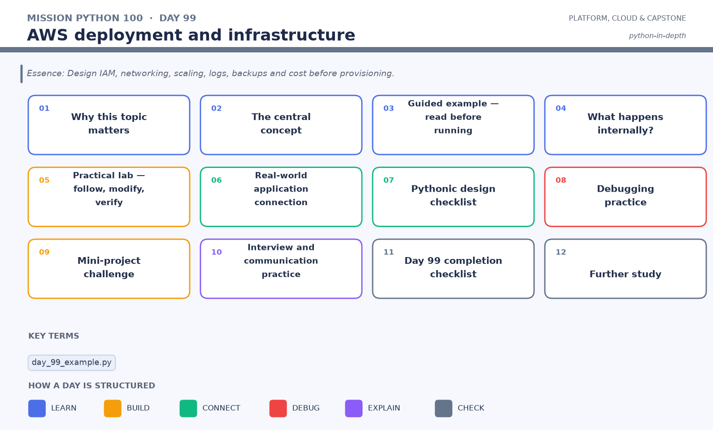

# 🐍 Mission Python 100 — Day 99

## AWS deployment and infrastructure

> **Goal:** Learn this topic from first principles, run an example yourself, inspect its behavior, and connect it to real application engineering.

| | |
|---|---|
| 📚 **Series** | Mission Python 100 |
| 🗓️ **Day** | 99 |
| 🎯 **Goal** | Learn this topic from first principles, run an example yourself, inspect its behavior, and connect it to real application engineering. |
| 🔗 **Study with** | [`README.md`](README.md) |

---

## 📑 Contents
1. [Why this topic matters](#1-why-this-topic-matters)
1. [The central concept](#2-the-central-concept)
1. [Guided example — read before running](#3-guided-example-read-before-running)
1. [What happens internally?](#4-what-happens-internally)
1. [Practical lab — follow, modify, verify](#5-practical-lab-follow-modify-verify)
1. [Real-world application connection](#6-real-world-application-connection)
1. [Pythonic design checklist](#7-pythonic-design-checklist)
1. [Debugging practice](#8-debugging-practice)
1. [Mini-project challenge](#9-mini-project-challenge)
1. [Interview and communication practice](#10-interview-and-communication-practice)
1. [Day 99 completion checklist](#11-day-99-completion-checklist)
1. [Further study](#12-further-study)

---

## 🗺️ Visual overview



## 1. Why this topic matters

A Python program grows from expressions and objects into functions, modules, services and systems. **AWS deployment and infrastructure** is one of those building blocks. It is useful to distinguish *what the feature does* from *why we choose it*. Design IAM, networking, scaling, logs, backups and cost before provisioning.

The habit to develop today: describe the requirement in ordinary language, predict the program's result, run the code, and then explain any differences. This is more valuable than copying syntax without understanding it.

## 2. The central concept

**Design IAM, networking, scaling, logs, backups and cost before provisioning.**

Python's readable syntax makes it easy to start, but production software also requires careful treatment of inputs, failures, dependencies, tests, and maintainability. For this chapter, concentrate on the specific feature in the title before attempting to generalize it.

## 3. Guided example — read before running

Create a file named `day_99_example.py` and enter:

```python
architecture={"compute":"ECS Fargate","database":"RDS","storage":"S3"}
print(architecture)
```

### Trace the execution

1. Read the first executable line: `architecture={"compute":"ECS Fargate","database":"RDS","storage":"S3"}`.
2. Identify every name introduced and the object or value it refers to.
3. Locate function calls, operations, conditions or loops; determine their evaluation order.
4. Predict the output **before** running the program.
5. Execute the file and compare the actual behavior with your prediction.

```bash
python day_99_example.py
```

If the example prints a Python version, timestamp, process ID, or third-party package version, the exact result will depend on your environment. Some chapters require optional libraries; the example reports when one is not installed.

## 4. What happens internally?

At a high level, the Python interpreter parses source code, compiles it into an executable representation (bytecode in CPython), and executes operations against Python objects. The code above uses language features and/or library APIs to perform the work. **Design IAM, networking, scaling, logs, backups and cost before provisioning.**

When analyzing internal behavior, ask which work is performed by Python itself, which is delegated to a library, and which requires the operating system or an external service. This distinction is particularly important when debugging performance and deployment issues.

## 5. Practical lab — follow, modify, verify

**Lab A — reproduce:** Run the supplied code exactly and record the output. If an optional package is absent, create a virtual environment and install only the documented dependency.

**Lab B — change one thing:** Modify a literal, input value, or collection in the example. Write down your predicted change in behavior, then execute it.

**Lab C — introduce an error:** Make a deliberate, reversible mistake (for example a misspelled name or wrong type). Capture the exception type, the line where it occurred, and the fix.

**Lab D — extract logic:** If the example performs a calculation or transformation, wrap that work in a named function with explicit parameters. If it is already a function, add a second test case.

**Lab E — edge cases:** Consider empty input, missing values, negative numbers, repeated requests, or unavailable dependencies, as appropriate to this chapter. Record which cases the example handles and which require more work.

## 6. Real-world application connection

Imagine this feature being used inside one of three systems: an employee/ERP application, an online fashion marketplace, or a ride-booking service. Write a small requirement using the day's topic. Example requirements include calculating totals, validating input, transforming records, coordinating service operations, or reporting errors. Your design should specify the input, expected output, failure case and test.

**Engineering note:** Design IAM, networking, scaling, logs, backups and cost before provisioning. Production code should also be reviewed for security, observability, resource usage and maintainability; not every example in a teaching chapter is production-ready.

## 7. Pythonic design checklist

- Prefer meaningful names over abbreviations.
- Keep each function focused on one responsibility.
- Avoid unnecessary nesting and clever one-liners.
- Validate data at external boundaries.
- Keep credentials and environment-specific configuration out of source code.
- Write tests for the expected result and at least one failure or edge case.

## 8. Debugging practice

When a run fails, answer these in order: **What did I expect? What actually happened? What line failed? What types and values were involved? Can I reproduce the problem with less code?** Fix the smallest cause and rerun the example. Do not suppress unexpected exceptions merely to make the terminal look clean.

## 9. Mini-project challenge

Build a small standalone demonstration titled **“AWS deployment and infrastructure in a real application.”** It should accept or define at least two different inputs, produce a clear result, and contain a comment explaining a business decision rather than merely restating the code. Add a `README` section with sample execution and limitations.

**Stretch challenge:** Design a second implementation and explain which is easier to read, test, and extend. Benchmark only when performance is relevant and you can measure it fairly.

## 10. Interview and communication practice

1. Explain **AWS deployment and infrastructure** without using the exact wording from this chapter.
2. What problem does this Python feature solve?
3. What happens internally when the sample runs?
4. Which edge cases or errors should a developer anticipate?
5. Where would you use it in a backend, DevOps or AI application?
6. What makes your implementation Pythonic rather than merely syntactically valid?

Speak your answer aloud for 60 seconds. Then rewrite it as a concise technical explanation for a teammate.

## 11. Day 99 completion checklist

- [ ] I can define the topic in my own words.
- [ ] I executed the example and predicted its behavior.
- [ ] I modified the code and explained the difference.
- [ ] I intentionally reproduced and fixed an error.
- [ ] I completed one real-world mini-project.
- [ ] I wrote at least one test or edge-case check.
- [ ] I can explain this topic in an interview.

```bash
git add day-99.md
git commit -m "day99: study aws deployment and infrastructure"
```

## 12. Further study

- [Python tutorial](https://docs.python.org/3/tutorial/)
- [Python language reference](https://docs.python.org/3/reference/)
- [Python standard library](https://docs.python.org/3/library/)
- [TutorialsPoint Python tutorial](https://www.tutorialspoint.com/python/index.htm)

> **Remember:** Understanding, testing and explaining one feature thoroughly is better than memorizing many features without practice.

---

| ⬅️ Previous | ➡️ Next |
|---|---|
| [Day 98](Day98-GitLab%20CICD%20pipelines.md) | [Day 100](Day100-Capstone-production-ready%20Python%20platform.md) |
| 🏁 **Day 99 complete** | **Return to [`README.md`](README.md)** |
