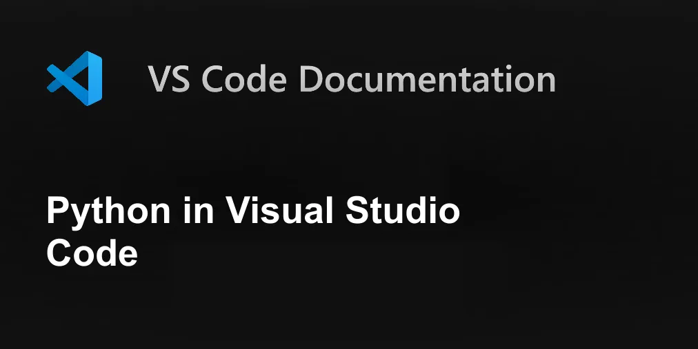

<div align="center">



# 🐍 Python in Depth: 100-Day Engineering Masterclass

**A comprehensive, production-grade engineering curriculum from CPython internals to enterprise cloud microservices.**

[](https://www.python.org/)
[](https://code.visualstudio.com/)
[]()
[]()

</div>

---

## 🌟 Welcome to Python in Depth

Welcome to **Python in Depth** — an exhaustive, zero-fluff engineering guide designed to take you from core programming concepts to building and operating robust, high-scale software systems.

Every chapter is engineered around practical mastery:

- **Interpreter Internals:** Understand bytecode, AST compilation, stack evaluation, and the CPython runtime.
- **Memory & Execution Models:** Grasp reference counting, heap allocation, cyclic garbage collection, and variable bindings.
- **Production Disciplines:** Master type hints, defensive validation, structured logging, testing with Pytest, and CI/CD pipelines.
- **Full-Scale Systems:** Architect real-world microservices, relational databases with SQLAlchemy, Redis caching, async event loops, and cloud deployments.

---

## 🖥️ Local Machine Setup & Quick Environment Check

Before starting, ensure your local workstation has an active Python runtime configured:

```bash
# Navigate to your project directory
cd d:/Python-in-Depth

# Run the Day 02 environment verification script
python day02_env_check.py
```

> [!TIP]
> Follow [Day 02: Installing Python and VS Code](<Day02-Installing Python and VS Code.md>) for full step-by-step guidance on setting up Python 3.12+, VS Code, virtual environments (`.venv`), interpreter selection, and debugging.

---

## 🗺️ Learning Roadmap & Phases

| Phase | Scope | Focus Areas | Real-World Deliverables |
|:---:|:---:|---|---|
| **Phase 1** | **Days 01–20** | **Language Foundations & Core Sequences** | CPython architecture, types, control flow, functions, lists, dicts, sets, tuples |
| **Phase 2** | **Days 21–40** | **Professional Python & Object-Oriented Design** | Scopes, modules, comprehensions, exceptions, files, decorators, OOP, dunder data model |
| **Phase 3** | **Days 41–60** | **Testing, Tooling, Algorithms & Concurrency** | Type hinting, logging, pdb, Pytest, packaging, memory profiling, threads, asyncio |
| **Phase 4** | **Days 61–80** | **Web APIs, Databases & Clean Architecture** | HTTP, FastAPI, Pydantic, SQL, transactions, SQLAlchemy, Redis caching, clean architecture |
| **Phase 5** | **Days 81–90** | **Large-Scale System Projects** | Fashion eCommerce platform, Uber-like ride booking engine, distributed system scaling |
| **Phase 6** | **Days 91–100** | **Data Science, AI & Production Cloud Deployment** | NumPy, Pandas, Scikit-learn, LLM APIs, RAG, Docker, CI/CD pipelines, AWS cloud capstone |

---

## 📚 Complete 100-Day Course Catalog

### Phase 1: Language Foundations & Core Sequences (Days 01–20)

| Day | Chapter Title | Topic Scope | Edition Status |
|:---:|---|---|:---:|
| **Day 01** | [Python, Programming & the Developer Mindset](<Day01-Python, Programming & the Developer Mindset.md>) | Python, Programming & the Developer Mindset | 💎 **Masterclass Edition** |
| **Day 02** | [Installing Python and VS Code](<Day02-Installing Python and VS Code.md>) | Installing Python and VS Code | 💎 **Masterclass Edition** |
| **Day 03** | [Python REPL and first programs](<Day03-Python REPL and first programs.md>) | Python REPL and first programs | 💎 **Masterclass Edition** |
| **Day 04** | [Pythonic style and PEP 8](<Day04-Pythonic style and PEP 8.md>) | Pythonic style and PEP 8 | 🚀 **Next Up** |
| **Day 05** | [ython syntax, indentation and comments](<Day05-ython syntax, indentation and comments.md>) | ython syntax, indentation and comments | Standard |
| **Day 06** | [Variables, names and object references](<Day06-Variables, names and object references.md>) | Variables, names and object references | Standard |
| **Day 07** | [Numbers-integers, floats and arithmetic](<Day07-Numbers-integers, floats and arithmetic.md>) | Numbers-integers, floats and arithmetic | Standard |
| **Day 08** | [Strings and Unicode](<Day08-Strings and Unicode.md>) | Strings and Unicode | Standard |
| **Day 09** | [Booleans, comparisons and truthiness](<Day09-Booleans, comparisons and truthiness.md>) | Booleans, comparisons and truthiness | Standard |
| **Day 10** | [Operators and precedence](<Day10-Operators and precedence.md>) | Operators and precedence | Standard |
| **Day 11** | [Input, output and conversion](<Day11-Input, output and conversion.md>) | Input, output and conversion | Standard |
| **Day 12** | [Conditionals-if, elif, else](<Day12-Conditionals-if, elif, else.md>) | Conditionals-if, elif, else | Standard |
| **Day 13** | [Loops-for, while, range](<Day13-Loops-for, while, range.md>) | Loops-for, while, range | Standard |
| **Day 14** | [Lists and mutable sequences](<Day14-Lists and mutable sequences.md>) | Lists and mutable sequences | Standard |
| **Day 15** | [Tuples and immutable records](<Day15-Tuples and immutable records.md>) | Tuples and immutable records | Standard |
| **Day 16** | [Sets and uniqueness](<Day16-Sets and uniqueness.md>) | Sets and uniqueness | Standard |
| **Day 17** | [Dictionaries and key-value data](<Day17-Dictionaries and key-value data.md>) | Dictionaries and key-value data | Standard |
| **Day 18** | [Slicing and sequence operations](<Day18-Slicing and sequence operations.md>) | Slicing and sequence operations | Standard |
| **Day 19** | [Functions and return values](<Day19-Functions and return values.md>) | Functions and return values | Standard |
| **Day 20** | [Parameters and argument passing](<Day20-Parameters and argument passing.md>) | Parameters and argument passing | Standard |


### Phase 2: Professional Python & Object-Oriented Design (Days 21–40)

| Day | Chapter Title | Topic Scope | Edition Status |
|:---:|---|---|:---:|
| **Day 21** | [Scope, LEGB and globals](<Day21-Scope, LEGB and globals.md>) | Scope, LEGB and globals | Standard |
| **Day 22** | [Modules and imports](<Day22-Modules and imports.md>) | Modules and imports | Standard |
| **Day 23** | [Modules and imports](<Day23-Modules and imports.md>) | Modules and imports | Standard |
| **Day 24** | [Comprehensions](<Day24-Comprehensions.md>) | Comprehensions | Standard |
| **Day 25** | [Exceptions and tracebacks](<Day25-Exceptions and tracebacks.md>) | Exceptions and tracebacks | Standard |
| **Day 26** | [Files and pathlib](<Day26-Files and pathlib.md>) | Files and pathlib | Standard |
| **Day 27** | [JSON and structured exchange](<Day27-JSON and structured exchange.md>) | JSON and structured exchange | Standard |
| **Day 28** | [CSV processing](<Day28-CSV processing.md>) | CSV processing | Standard |
| **Day 29** | [Datetime and time zones](<Day29-Datetime and time zones.md>) | Datetime and time zones | Standard |
| **Day 30** | [Regular expressions](<Day30-Regular expressions.md>) | Regular expressions | Standard |
| **Day 31** | [Iterators and iteration protocol](<Day31-Iterators and iteration protocol.md>) | Iterators and iteration protocol | Standard |
| **Day 32** | [Generators and lazy evaluation](<Day32-Generators and lazy evaluation.md>) | Generators and lazy evaluation | Standard |
| **Day 33** | [Lambda and higher-order functions](<Day33-Lambda and higher-order functions.md>) | Lambda and higher-order functions | Standard |
| **Day 34** | [Closures and decorators](<Day34-Closures and decorators.md>) | Closures and decorators | Standard |
| **Day 35** | [Recursion and call stacks](<Day35-Recursion and call stacks.md>) | Recursion and call stacks | Standard |
| **Day 36** | [Object-oriented foundations](<Day36-Object-oriented foundations.md>) | Object-oriented foundations | Standard |
| **Day 37** | [Instance, class and static methods](<Day37-Instance, class and static methods.md>) | Instance, class and static methods | Standard |
| **Day 38** | [Encapsulation and properties](<Day38-Encapsulation and properties.md>) | Encapsulation and properties | Standard |
| **Day 39** | [Inheritance and composition](<Day39-Inheritance and composition.md>) | Inheritance and composition | Standard |
| **Day 40** | [Polymorphism and duck typing](<Day40-Polymorphism and duck typing.md>) | Polymorphism and duck typing | Standard |


### Phase 3: Testing, Tooling, Algorithms & Concurrency (Days 41–60)

| Day | Chapter Title | Topic Scope | Edition Status |
|:---:|---|---|:---:|
| **Day 41** | [Dataclasses and enums](<Day41-Dataclasses and enums.md>) | Dataclasses and enums | Standard |
| **Day 42** | [Dunder methods and Python data model](<Day42-Dunder methods and Python data model.md>) | Dunder methods and Python data model | Standard |
| **Day 43** | [Type hints and static analysis](<Day43-Type hints and static analysis.md>) | Type hints and static analysis | Standard |
| **Day 44** | [Assertions and defensive validation](<Day44-Assertions and defensive validation.md>) | Assertions and defensive validation | Standard |
| **Day 45** | [Logging and observability basics](<Day45-Logging and observability basics.md>) | Logging and observability basics | Standard |
| **Day 46** | [Debugging with pdb and tracebacks](<Day46-Debugging with pdb and tracebacks.md>) | Debugging with pdb and tracebacks | Standard |
| **Day 47** | [Unit tests with unittest](<Day47-Unit tests with unittest.md>) | Unit tests with unittest | Standard |
| **Day 48** | [Pytest and test organization](<Day48-Pytest and test organization.md>) | Pytest and test organization | Standard |
| **Day 49** | [Mocking and dependency injection](<Day49-Mocking and dependency injection.md>) | Mocking and dependency injection | Standard |
| **Day 50** | [Virtual environments and packaging](<Day50-Virtual environments and packaging.md>) | Virtual environments and packaging | Standard |
| **Day 51** | [CLI applications and argparse](<Day51-CLI applications and argparse.md>) | CLI applications and argparse | Standard |
| **Day 52** | [Configuration and environment variables](<Day52-Configuration and environment variables.md>) | Configuration and environment variables | Standard |
| **Day 53** | [Context managers](<Day53-Context managers.md>) | Context managers | Standard |
| **Day 54** | [Memory model and garbage collection](<Day54-Memory model and garbage collection.md>) | Memory model and garbage collection | Standard |
| **Day 55** | [Performance and profiling](<Day55-Performance and profiling.md>) | Performance and profiling | Standard |
| **Day 56** | [Performance and profiling](<Day56-Performance and profiling.md>) | Performance and profiling | Standard |
| **Day 57** | [Searching and sorting](<Day57-Searching and sorting.md>) | Searching and sorting | Standard |
| **Day 58** | [Stacks, queues and heaps](<Day58-Stacks, queues and heaps.md>) | Stacks, queues and heaps | Standard |
| **Day 59** | [Concurrency-threads](<Day59-Concurrency-threads.md>) | Concurrency-threads | Standard |
| **Day 60** | [Concurrency-processes](<Day60-Concurrency-processes.md>) | Concurrency-processes | Standard |


### Phase 4: Web APIs, Databases & Clean Architecture (Days 61–80)

| Day | Chapter Title | Topic Scope | Edition Status |
|:---:|---|---|:---:|
| **Day 61** | [Asyncio and coroutines](<Day61-Asyncio and coroutines.md>) | Asyncio and coroutines | Standard |
| **Day 62** | [HTTP fundamentals](<Day62-HTTP fundamentals.md>) | HTTP fundamentals | Standard |
| **Day 63** | [REST APIs and resource design](<Day63-REST APIs and resource design.md>) | REST APIs and resource design | Standard |
| **Day 64** | [FastAPI first endpoint](<Day64-FastAPI first endpoint.md>) | FastAPI first endpoint | Standard |
| **Day 65** | [Pydantic and request validation](<Day65-Pydantic and request validation.md>) | Pydantic and request validation | Standard |
| **Day 66** | [API routing and dependency injection](<Day66-API routing and dependency injection.md>) | API routing and dependency injection | Standard |
| **Day 67** | [Authentication and authorization](<Day67-Authentication and authorization.md>) | Authentication and authorization | Standard |
| **Day 68** | [Password hashing and secrets](<Day68-Password hashing and secrets.md>) | Password hashing and secrets | Standard |
| **Day 69** | [Relational database fundamentals](<Day69-Relational database fundamentals.md>) | Relational database fundamentals | Standard |
| **Day 70** | [SQL joins and aggregates](<Day70-SQL joins and aggregates.md>) | SQL joins and aggregates | Standard |
| **Day 71** | [Transactions and ACID](<Day71-Transactions and ACID.md>) | Transactions and ACID | Standard |
| **Day 72** | [ORMs and SQLAlchemy](<Day72-ORMs and SQLAlchemy.md>) | ORMs and SQLAlchemy | Standard |
| **Day 73** | [Database migrations](<Day73-Database migrations.md>) | Database migrations | Standard |
| **Day 74** | [Caching and Redis concepts](<Day74-Caching and Redis concepts.md>) | Caching and Redis concepts | Standard |
| **Day 75** | [Caching and Redis concepts](<Day75-Caching and Redis concepts.md>) | Caching and Redis concepts | Standard |
| **Day 76** | [Application layering and clean architecture](<Day76-Application layering and clean architecture.md>) | Application layering and clean architecture | Standard |
| **Day 77** | [API error handling and contracts](<Day77-API error handling and contracts.md>) | API error handling and contracts | Standard |
| **Day 78** | [Pagination, filtering and sorting](<Day78-Pagination, filtering and sorting.md>) | Pagination, filtering and sorting | Standard |
| **Day 79** | [Pagination, filtering and sorting](<Day79-Pagination, filtering and sorting.md>) | Pagination, filtering and sorting | Standard |
| **Day 80** | [Fashion app-domain and data model](<Day80-Fashion app-domain and data model.md>) | Fashion app-domain and data model | Standard |


### Phase 5: Real-World Systems & System Design (Days 81–90)

| Day | Chapter Title | Topic Scope | Edition Status |
|:---:|---|---|:---:|
| **Day 81** | [Fashion app-catalog and inventory](<Day81-Fashion app-catalog and inventory.md>) | Fashion app-catalog and inventory | Standard |
| **Day 82** | [Fashion app-cart and checkout](<Day82-Fashion app-cart and checkout.md>) | Fashion app-cart and checkout | Standard |
| **Day 83** | [Fashion app-payments and orders](<Day83-Fashion app-payments and orders.md>) | Fashion app-payments and orders | Standard |
| **Day 84** | [Uber-like app-ride domain](<Day84-Uber-like app-ride domain.md>) | Uber-like app-ride domain | Standard |
| **Day 85** | [Uber-like app-fare calculation](<Day85-Uber-like app-fare calculation.md>) | Uber-like app-fare calculation | Standard |
| **Day 86** | [Uber-like app-driver matching](<Day86-Uber-like app-driver matching.md>) | Uber-like app-driver matching | Standard |
| **Day 87** | [Uber-like app-trip state machine](<Day87-Uber-like app-trip state machine.md>) | Uber-like app-trip state machine | Standard |
| **Day 88** | [System design-scaling and reliability](<Day88-System design-scaling and reliability.md>) | System design-scaling and reliability | Standard |
| **Day 89** | [Data analysis with NumPy](<Day89-Data analysis with NumPy.md>) | Data analysis with NumPy | Standard |
| **Day 90** | [Pandas and data cleaning](<Day90-Pandas and data cleaning.md>) | Pandas and data cleaning | Standard |


### Phase 6: Data Science, AI, Containers & Cloud Deployment (Days 91–100)

| Day | Chapter Title | Topic Scope | Edition Status |
|:---:|---|---|:---:|
| **Day 91** | [Data visualization and reporting](<Day91-Data visualization and reporting.md>) | Data visualization and reporting | Standard |
| **Day 92** | [Machine learning foundations](<Day92-Machine learning foundations.md>) | Machine learning foundations | Standard |
| **Day 93** | [Scikit-learn workflow](<Day93-Scikit-learn workflow.md>) | Scikit-learn workflow | Standard |
| **Day 94** | [LLM APIs and prompt engineering](<Day94-LLM APIs and prompt engineering.md>) | LLM APIs and prompt engineering | Standard |
| **Day 95** | [RAG and embeddings concepts](<Day95-RAG and embeddings concepts.md>) | RAG and embeddings concepts | Standard |
| **Day 96** | [AI agents and tool calling](<Day96-AI agents and tool calling.md>) | AI agents and tool calling | Standard |
| **Day 97** | [Docker and containerization](<Day97-Docker and containerization.md>) | Docker and containerization | Standard |
| **Day 98** | [GitLab CICD pipelines](<Day98-GitLab CICD pipelines.md>) | GitLab CICD pipelines | Standard |
| **Day 99** | [AWS deployment and infrastructure](<Day99-AWS deployment and infrastructure.md>) | AWS deployment and infrastructure | Standard |
| **Day 100** | [Capstone-production-ready Python platform](<Day100-Capstone-production-ready Python platform.md>) | Capstone-production-ready Python platform | Standard |


---

## 💡 How to Study for Maximum Retention

1. **Read & Deconstruct:** Review the architectural diagrams and understand *why* the language behaves the way it does.
2. **Execute Every Snippet:** Never read code passively. Run each file in your integrated terminal with `python <file>.py`.
3. **Experiment & Break:** Change arguments, trigger exceptions, and inspect tracebacks to build diagnostic muscle memory.
4. **Build the Assignment:** Finish the real-world mini-project at the end of each chapter before moving forward.

---

<div align="center">

<sub>Python in Depth © 2026 • Designed for ambitious software engineers.</sub>
</div>
